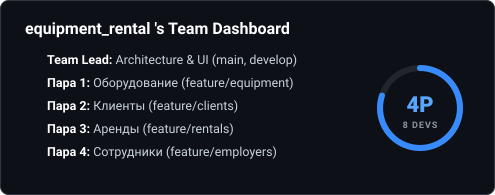
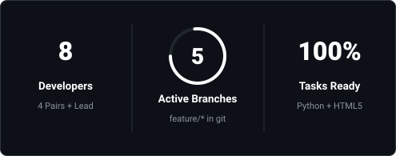

<div align="center">

# *hey, we're equipment_rental*

<br/>

<a href="https://github.com/orgs/Interlink-Labs/projects/6"></a>
<a href="http://127.0.0.1:8000/docs"></a>

<br/><br/>

### *tech stack*

<p align="center">
  
  
</p>

<hr/>

</div>

<div align="center">

## 🗂️ *team dashboard*

<br/>



<br/><br/>



<br/><br/>

<details>
<summary><b>📋 Нажмите, чтобы развернуть подробный список задач по парам</b></summary>
<br/>

| Направление | Ветка | Основные файлы | Задачи |
|---|---|---|---|
| 👑 **Team Lead** | `develop`, `main` | `templates/index.html`, PR | Архитектура, код-ревью, слияние веток, верстка HTML |
| 🛠️ **Пара 1: Оборудование** | `feature/equipment` | `routers/equipment.py` | CRUD инструментов, проверка инв. номера, фильтры |
| 👤 **Пара 2: Клиенты** | `feature/clients` | `routers/clients.py` | База клиентов, уникальность номеров, поиск |
| 📅 **Пара 3: Аренды** | `feature/rentals` | `routers/rentals.py`, `services.py` | Проверка дат, расчет стоимости, смена статусов |
| 👔 **Пара 4: Сотрудники / Доступ** | `feature/employers` | `routers/employers.py` | Учет менеджеров, роли, авторизация |

</details>

</div>

---

## 🚀 Быстрый запуск на компьютере

### 1. Создать виртуальное окружение (1 раз)
```bash
python -m venv venv
```

### 2. Активировать окружение
- **Windows (PowerShell):** `venv\Scripts\Activate.ps1`
- **Windows (CMD):** `venv\Scripts\activate.bat`
- **macOS / Linux:** `source venv/bin/activate`

### 3. Установить библиотеки
```bash
pip install -r requirements.txt
```

### 4. Запустить сервер
```bash
python main.py
```
*или команда uvicorn:*
```bash
uvicorn main:app --reload
```

---

## 🌐 Локальные эндпоинты

- **Веб-интерфейс:** [http://127.0.0.1:8000](http://127.0.0.1:8000)
- **Интерактивный Swagger API:** [http://127.0.0.1:8000/docs](http://127.0.0.1:8000/docs)

---

## 📁 Структура проекта

```text
equipment_rental/
├── main.py              # Точка входа и объединение маршрутов
├── database.py          # Подключение к SQLite (equipment_rental.db)
├── models.py            # Модели таблиц (Equipment, Client, Rental, Employer)
├── schemas.py           # Pydantic схемы валидации
├── services.py          # Бизнес-логика (расчет цен, проверка дат)
├── routers/             # Роутеры по парам
│   ├── equipment.py     # Зона ответственности Пары 1
│   ├── clients.py       # Зона ответственности Пары 2
│   ├── rentals.py       # Зона ответственности Пары 3
│   └── employers.py     # Зона ответственности Пары 4
├── templates/
│   └── index.html       # HTML интерфейс (Team Lead)
├── static/
│   ├── style.css        # Стили
│   └── app.js           # Фронтенд-скрипты
├── requirements.txt     # Зависимости
├── CONTRIBUTING.md      # Правила работы с ветками
└── README.md            # Документация проекта
```

---

<div align="center">
  <sub>made with ❤️ by team of 8 developers • interlink labs • 2026</sub>
</div>
