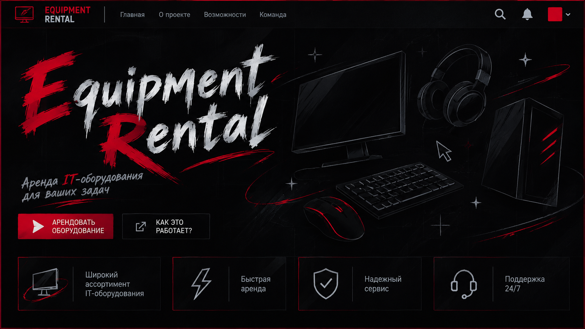

<div align="center">

# Equipment Rental

**Аренда оборудования для разработки**

Каталог ноутбуков, рабочих станций и плат для программирования и тестирования.


[Быстрый запуск](#быстрый-запуск) · [Структура проекта](#структура-проекта) · [Правила работы](./CONTRIBUTING.md) · [Доска команды](https://github.com/orgs/Interlink-Labs/projects/6)

</div>

---

## Возможности

| Раздел | Что в нём |
| --- | --- |
| **Оборудование** | Каталог с дневными тарифами и инвентарными номерами |
| **Клиенты** | Карточки клиентов с контактными данными |
| **Аренды** | Оформление аренды и брони, расчёт стоимости по датам |
| **Сотрудники** | Учёт сотрудников и их ролей |

В браузере доступен каталог оборудования. Маршруты всех разделов собраны в Swagger.

## Быстрый запуск

Откройте терминал в папке проекта и создайте виртуальное окружение.

```bash
python -m venv venv
```

Активируйте его командой для своей системы.

| Терминал | Команда |
| --- | --- |
| Windows PowerShell | `venv\Scripts\Activate.ps1` |
| Windows CMD | `venv\Scripts\activate.bat` |
| macOS / Linux | `source venv/bin/activate` |

Установите зависимости и запустите сервер.

```bash
python -m pip install -r requirements.txt
python main.py
```

[Открыть каталог](http://127.0.0.1:8000/) · [Открыть Swagger](http://127.0.0.1:8000/docs)

## Структура проекта

<table>
  <thead>
    <tr>
      <th scope="col">Блок</th>
      <th scope="col">Файлы</th>
      <th scope="col">Назначение</th>
    </tr>
  </thead>
  <tbody>
    <tr>
      <th scope="row">🟥 Запуск</th>
      <td><a href="./main.py"><code>main.py</code></a><br><a href="./requirements.txt"><code>requirements.txt</code></a></td>
      <td>Запуск FastAPI и зависимости проекта</td>
    </tr>
    <tr>
      <th scope="row">🟥 Данные</th>
      <td><a href="./database.py"><code>database.py</code></a><br><a href="./models.py"><code>models.py</code></a><br><a href="./schemas.py"><code>schemas.py</code></a></td>
      <td>Подключение SQLite, модели таблиц и проверка данных</td>
    </tr>
    <tr>
      <th scope="row">🟥 API</th>
      <td><a href="./routers/"><code>routers/</code></a><br><a href="./services.py"><code>services.py</code></a></td>
      <td>Маршруты по разделам, расчёт стоимости и проверка дат</td>
    </tr>
    <tr>
      <th scope="row">🟥 Интерфейс</th>
      <td><a href="./templates/"><code>templates/</code></a><br><a href="./static/"><code>static/</code></a></td>
      <td>Разметка, стили и JavaScript</td>
    </tr>
  </tbody>
</table>



---

<div align="center">
  <sub>Учебный проект команды Interlink Labs · 2026</sub>
</div>
